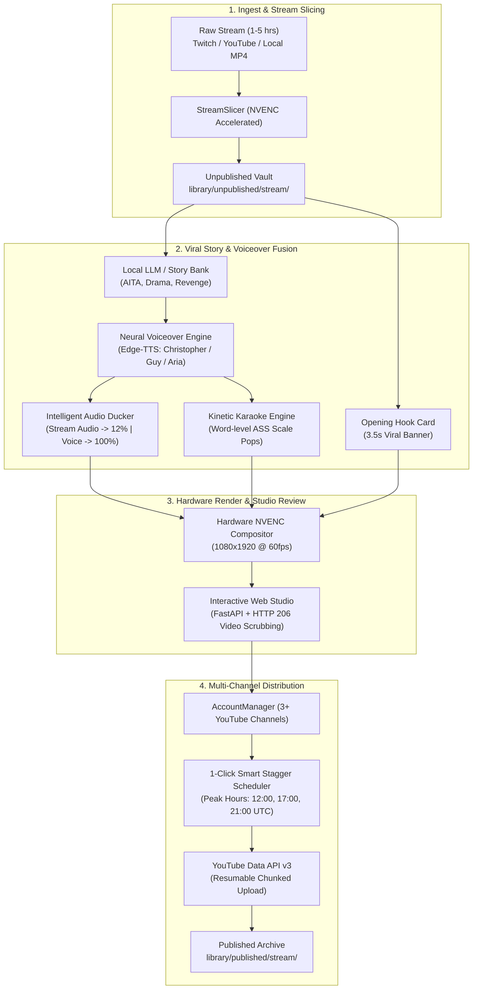

# 🎬 AutoClip-Local

> ### *"Bro really thought you needed a $40/month Opus Clip subscription to edit viral shorts... skill issue fr fr 💀🔥"*
> **The next-generation, 100% local, GPU-accelerated video clipping and viral shorts repurposing engine built for creators and engineers who refuse to pay cloud rent.**

[](https://python.org)
[](https://developer.nvidia.com/cuda-toolkit)
[](https://developer.nvidia.com/video-encode-decode-gpu-support-matrix)
[-brightgreen?style=for-the-badge)](#)
[](https://github.com/SYSTRAN/faster-whisper)
[](#)
[](https://developers.google.com/youtube/v3)
[](#)
[](LICENSE)
[](#)

---

## 💀 The Lore (Why did we cook this?)

Picture this: You are a content creator or streamer. You just wrapped a 3-hour Twitch or YouTube live stream filled with hilarious gaming moments, intense gameplay, or storytelling gold. You want to repurpose it into viral 9:16 vertical shorts for YouTube Shorts, TikTok, and Instagram Reels...

And what happens?
* **Opus Clip & Submagic:** Want **$30–$60 every single month**. They ration you to 150 minutes of video, force you to upload multi-gigabyte recordings across sluggish internet to their cloud servers (taking 25 minutes before processing even starts), downscale your footage, slap watermarks on your work, and hold your private content on third-party cloud buckets. 🤡💸
* **Premiere Pro / DaVinci Resolve:** You sit down for **4 tedious hours** manually cutting 2-minute clips, hand-keyframing 9:16 vertical crops, squinting at waveform monitors, and painfully typing out kinetic subtitle animations word-by-word. Absolute slideshow behavior. 📉
* **Generic Python Scripts:** Fragmented open-source repos that break on the first non-standard audio sample rate, have zero GUI, ignore NVIDIA NVENC hardware encoders, and choke on any video longer than 10 minutes.

We said: **NAH, WE’D WIN.**

We architected **AutoClip-Local** as a standalone, 100% local, high-throughput video repurposing workstation engine that runs entirely on local consumer hardware (NVIDIA RTX GPUs, Intel/AMD CPUs, and Apple Silicon). Zero subscription fees. Zero cloud API keys. Zero cloud bandwidth upload latency. Unlimited 4K/1080p exports. Pure local compute supremacy. 🚀🔥

---

## 🥊 The Showdown Matrix (Who is cooked?)

| Feature / Metric | Opus Clip ☁️ | Submagic 🪄 | Manual Premiere 🐢 | Generic Scripts 🐍 | 🎬 AutoClip-Local 🚀 |
| :--- | :--- | :--- | :--- | :--- | :--- |
| **Monthly Cost** | $30 – $60 / mo 💸 | $40 – $70 / mo 💸 | $24 / mo Adobe Tax | Free (broken) | **$0.00 Forever (MIT)** 🥇 |
| **Data Privacy** | Cloud Upload (0% Private) | Cloud Upload (0% Private) | Local Disk | Local Disk | **100% Local & Airgapped** 🛡️ |
| **Hardware Encoding** | Server Queues | Server Queues | Manual Export | CPU-bound (slow) | **NVIDIA NVENC Hardware Fast** ⚡ |
| **1–5 Hour Stream Slicing** | ❌ Hard Limits / Extra Fees | ❌ Fails on >15 min VODs | ⚠️ 4 Hours of Manual Cuts | ❌ Out-of-Memory Crash | **✅ Instant 2-Min Vertical Slicing** 🍰 |
| **Story & Voiceover Fusion** | ❌ Not Supported | ❌ Not Supported | ⚠️ Manual Recording & Timing | ❌ Not Supported | **✅ HarryTalks Viral AITA Studio** 🎭 |
| **Audio Ducking** | ❌ Primitive / None | ❌ Primitive / None | Manual Keyframes | ❌ None | **✅ Auto 12% Background Ducking** 🎚️ |
| **Kinetic Karaoke Subtitles** | Preset Styles Only | Watermarked on Free Tier | Manual Text Layer Hell | ❌ Raw SRT Only | **✅ Fused `.ass` Pop Animations** 🔤 |
| **Stacked Gaming Cropper** | ❌ Crop Only | ❌ Crop Only | Manual Picture-in-Picture | ❌ Crop Only | **✅ 35% Facecam + 65% Game Stack** 🎮 |
| **Multi-Channel Scheduling** | ❌ 1 Account per Tier | ❌ 1 Account per Tier | ❌ Manual Web Uploads | ❌ None | **✅ 3+ Channels Smart Stagger** 📅 |

---

## 🆚 What is Different Between Ours and Others? (The Deep Dive)

Most tools treat AI video repurposing as a cloud SaaS commodity designed to extract recurring subscriptions from creators. **AutoClip-Local** approaches video repurposing from a systems engineering mindset—treating hardware video transcoders, local tensor engines, and audio signal processing as a unified local pipeline.

### 1. Continuous 1–5 Hour Stream Slicing (`StreamSlicer`)
* **Others:** Cloud services force you to trim videos before upload or charge prohibitive token surcharges for files longer than 20 minutes.
* **AutoClip-Local:** Direct ingest of massive 1-to-5 hour live streams directly from Twitch / YouTube (via `yt-dlp`) or local MP4/MKV recordings. Slices footage into back-to-back **2-minute 9:16 vertical shorts** (1080x1920) using hardware NVIDIA NVENC (`h264_nvenc`) with zero CPU bottlenecks. Slices are automatically indexed into the **Unpublished Vault** (`library/unpublished/<stream_name>/`), isolated and ready for immediate narrative enhancement.

### 2. Story & Neural Voiceover Fusion Studio (`StoryNarrator`)
* **Others:** Require you to bring your own voiceover audio or pay for ElevenLabs API credits.
* **AutoClip-Local:** Recreates the high-retention viral style of [HarryTalks YouTube Shorts](https://youtube.com/shorts/H3spw3wzw24):
  * **AITA & Gripping Drama Narratives:** Generates first-person viral hooks and suspenseful resolutions via local LLMs (Sandwich.cpp / llama-server) or built-in viral story banks.
  * **Neural Voiceover:** Synthesizes natural, emotive narration via Edge-TTS (`Christopher`, `Guy`, `Aria`, `Jenny`, `Eric`, `Ryan`) with zero API keys or latency penalties.
  * **Automatic Audio Ducking:** Automatically calculates root-mean-square (RMS) speech boundaries and ducks background stream/gameplay audio down to **10–15%** volume, while boosting the narrative voiceover to **100%**.
  * **Dynamic Hook Card:** Renders a 3.5-second top banner card displaying the viral headline to immediately lock viewer attention in the first 3 seconds of the short.

### 3. Kinetic Karaoke Subtitle Engine (`KineticASSBuilder`)
* **Others:** Provide plain SRT subtitles or generic text overlays that fail to hold modern short-form viewer attention.
* **AutoClip-Local:** Employs word-level timestamp alignment from `faster-whisper` and compiles custom Advanced SubStation Alpha (`.ass`) subtitle streams. Generates dynamic word-by-word scaling pops (`\fscx115\fscy115`) with vibrant yellow active highlights (`\c&H0000FFFF&`), dark drop-shadows, and crisp font geometry rendered directly inside the video stream.

### 4. Stacked Gaming Crop & Intelligent Reframing (`StackedCropper`)
* **Others:** Simple center-crops that cut off either the streamer's facecam or the critical in-game crosshairs/UI.
* **AutoClip-Local:** Formats horizontal 16:9 gaming streams into high-engagement vertical shorts via a geometry solver:
  * **Top 35% Section:** Zooms and centers the streamer's facecam using MediaPipe face detection.
  * **Bottom 65% Section:** Captures central gameplay action, eliminating black letterbox bars and keeping viewers engaged.

### 5. Multi-Channel YouTube Scheduler & Smart Stagger (`AccountManager`)
* **Others:** Require manually downloading rendered MP4s and uploading them one-by-one inside YouTube Studio.
* **AutoClip-Local:** Built-in multi-channel management with strict vault safety:
  * **3+ Channel Support:** Connect and switch between multiple independent YouTube brand channels with isolated OAuth tokens.
  * **Vault State Transition:** When a clip is scheduled, it is automatically migrated from `library/unpublished/<stream>/` to `library/published/<stream>/` with a cryptographic publication receipt, guaranteeing zero duplicate uploads.
  * **1-Click Smart Stagger:** Automatically schedules 20 to 100+ clips across connected channels over a 7-day calendar, targeting peak viral viewing windows (12:00, 17:00, 21:00 UTC).

### 6. Interactive Web Studio Dashboard
* **Others:** Bloated electron apps or command-line-only scripts with zero visual feedback.
* **AutoClip-Local:** A lightweight, dark-mode web studio built on **FastAPI + Tailwind CSS + Lucide Icons**:
  * **HTTP 206 Partial Content Streaming:** Instantaneous video scrubbing across multi-gigabyte clips without buffering.
  * **Live Hardware Telemetry:** Real-time HUD showing NVIDIA GPU NVENC status, VRAM usage, and active models.
  * **Single-Click Batch Actions:** Generate stories, preview voiceovers, and schedule uploads directly from your browser.

---

## 🏗️ Architecture Pipeline



---

## 📦 Repository Layout

```text
autoclip-local/
├── Dockerfile                  # CUDA 12.2 + FFmpeg NVENC container environment
├── docker-compose.yml          # One-click GPU passthrough deployment
├── pyproject.toml              # Build specification and CLI entry points
├── requirements.txt            # Python dependencies
├── library/
│   ├── unpublished/            # Vault of sliced clips awaiting narrative fusion & scheduling
│   └── published/              # Archived clips scheduled/published with JSON receipts
├── raw_streams/                # Storage directory for ingested 1-5 hr stream recordings
├── autoclip/
│   ├── cli.py                  # Unified CLI commands (studio, slice, fuse-story, publish)
│   ├── config.py               # Hardware detection and configuration engine
│   ├── stream/
│   │   └── slicer.py           # 1-to-5 hour stream download & 2-min vertical slicer
│   ├── story/
│   │   ├── generator.py        # Local LLM viral story generation & curated templates
│   │   └── narrator.py         # TTS synthesis, audio ducking, hook cards, & ASS fusion
│   ├── publisher/
│   │   ├── account_manager.py  # Multi-channel manager & Smart Stagger scheduler
│   │   └── youtube_scheduler.py# Resumable scheduled YouTube upload client
│   ├── web/
│   │   ├── app.py              # FastAPI backend API & HTTP 206 video streamer
│   │   └── templates/
│   │       └── index.html      # Complete dark-mode interactive Studio UI
│   ├── audio/
│   │   └── transcriber.py      # faster-whisper with word-level alignment
│   ├── intelligence/
│   │   ├── prompt.py           # Few-shot viral hook scoring prompts
│   │   ├── segmenter.py        # Local LLM virality ranking & JSON parser
│   │   └── audio_spike_detector.py # RMS energy Z-score hype moment detector
│   ├── vision/
│   │   ├── face_tracker.py     # MediaPipe & OpenCV face tracking
│   │   ├── reframer.py         # EMA 9:16 vertical crop solver
│   │   └── gaming_stacked_crop.py # 35% webcam + 65% gameplay stacked cropper
└── tests/
    ├── test_smoke.py           # Reframing, subtitles, and NVENC render tests
    ├── test_addons.py          # Publisher, stacked cropper, and hype detector tests
    └── test_studio.py          # Studio slicing, story fusion, scheduler, and API tests
```

---

## 🚀 Quickstart Guide

### Option A: Local Python Workstation

```bash
# 1. Clone the repository
git clone https://github.com/sandeepmuttvarpu-png/autoclip-local.git
cd autoclip-local

# 2. Create and activate virtual environment
python3 -m venv .venv
source .venv/bin/activate

# 3. Install package in editable mode
pip install -e .

# 4. Launch the Web Studio Dashboard
autoclip studio --port 8501
```
Open your browser at **`http://localhost:8501`**.

---

### Option B: Docker with NVIDIA GPU Passthrough

```bash
# 1. Build and launch container in background
docker compose up -d

# 2. Monitor real-time logs
docker compose logs -f autoclip-studio
```
The studio dashboard is accessible at **`http://localhost:8501`**.

---

## 🛠️ CLI Workflows

### 1. Slice a 1–5 hr Stream into 2-Minute Shorts
```bash
# Download and slice Twitch or YouTube VOD
autoclip slice "https://www.youtube.com/watch?v=..." --duration 120

# Slice a local stream recording
autoclip slice "raw_streams/stream.mp4" --duration 120 --output-dir library/unpublished
```

### 2. Fuse Story, Voiceover, & Kinetic Subtitles
```bash
autoclip fuse-story library/unpublished/my_stream/my_stream_clip_001.mp4 \
  --category aita \
  --voice en-US-ChristopherNeural
```

### 3. Schedule YouTube Short Upload
```bash
autoclip publish library/unpublished/my_stream/my_stream_clip_001.mp4 \
  --title "AITA For Exposing My Fiancée's Secret Account? #Shorts" \
  --publish-at "2026-10-29T18:00:00Z"
```

---

## 🧪 Testing & Verification

Run the full automated verification test suite:
```bash
pytest -v
```

```text
============================= test session starts ==============================
collected 19 items

tests/test_addons.py::test_youtube_publish_at_formatter PASSED           [  5%]
tests/test_addons.py::test_youtube_missing_credentials_error PASSED      [ 10%]
tests/test_addons.py::test_youtube_scheduled_upload_mock PASSED          [ 15%]
tests/test_addons.py::test_gaming_stacked_geometry PASSED                [ 21%]
tests/test_addons.py::test_gaming_stacked_render_end_to_end PASSED       [ 26%]
tests/test_addons.py::test_audio_spike_detection_synthetic PASSED        [ 31%]
tests/test_smoke.py::test_reframer_aspect_ratio PASSED                   [ 36%]
tests/test_smoke.py::test_kinetic_ass_builder PASSED                     [ 42%]
tests/test_smoke.py::test_segmenter_json_parsing PASSED                  [ 47%]
tests/test_smoke.py::test_end_to_end_nvenc_render PASSED                 [ 52%]
tests/test_studio.py::test_stream_slicer PASSED                          [ 57%]
tests/test_studio.py::test_story_generator_fallback_and_custom PASSED    [ 63%]
tests/test_studio.py::test_story_narrator_subtitles_and_ducking PASSED   [ 68%]
tests/test_studio.py::test_account_manager_state_transition PASSED       [ 73%]
tests/test_studio.py::test_account_manager_smart_stagger PASSED          [ 78%]
tests/test_studio.py::test_web_api_status_and_voices PASSED              [ 84%]
tests/test_studio.py::test_web_api_story_generation PASSED               [ 89%]
tests/test_studio.py::test_web_api_accounts_list PASSED                  [ 94%]
tests/test_studio.py::test_web_api_video_streaming PASSED                [100%]

======================== 19 passed, 1 warning in 24.04s ========================
```

---

## 📄 License & Attribution

* **Creator:** Sandeep Muttvarpu ([@sandeepmuttvarpu-png](https://github.com/sandeepmuttvarpu-png))
* **License:** [MIT License](LICENSE) — 100% free and open-source for creators and developers worldwide.
