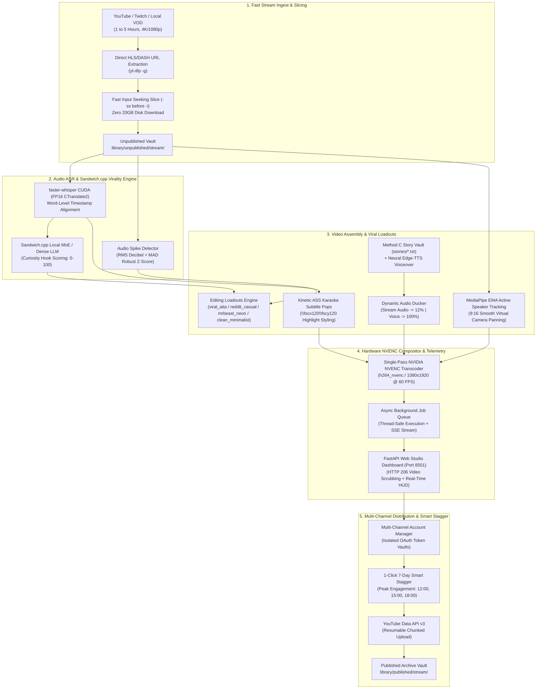

# 🎬 AutoClip-Local

> ### *"Bro really thought you needed a $40/month Opus Clip subscription to slice 9:16 vertical shorts... skill issue fr fr 💀🔥"*
> **The next-generation, 100% local, GPU-accelerated video repurposing & viral shorts creation studio that slices multi-hour 4K streams in seconds without downloading 20GB files, tracks speakers via MediaPipe, ranks virality via Sandwich.cpp, and schedules releases on YouTube.**

[](LICENSE)
[](https://developer.nvidia.com/cuda-toolkit)
[](https://developer.nvidia.com/video-encode-decode-gpu-support-matrix)
[](#)
[](#)
[](#)
[](http://localhost:5001)
[](#)
[](#)

---

## 💀 The Lore (Why did we cook this?)

Picture this: You are a creator or streamer. You just wrapped an epic 3-hour Twitch or YouTube live stream filled with clutches, funny banter, and viral story moments. You want to repurpose it into high-retention 9:16 vertical shorts for YouTube Shorts, TikTok, and Instagram Reels...

And what happens?
* **Opus Clip & Submagic:** Hit you with a **$40–$60/month cloud tax**. They ration you to 150 minutes of video per month, force you to upload 15GB files over home Wi-Fi (taking 45 minutes before processing even begins), queue your render behind 500 other people, slap watermarks on your drafts, and hold your private content on external cloud servers. Absolute robbery. 🤡💸
* **The 20GB Download Trap:** Naive open-source tools force you to download the **entire 20GB 4K YouTube video** to disk first just to extract a single 45-second clip. Your NVMe drive screams for mercy, your bandwidth is throttled, and your CPU is locked in 100% disk I/O purgatory. 📉
* **Manual Premiere Pro / DaVinci Resolve:** You sit down for **4 tedious hours** hand-keyframing 9:16 vertical crops, manually timing word-by-word subtitle layers, adjusting drop shadows, and wrestling with timeline markers until Premiere decides to crash right as you click render. Slideshow behavior. 🐢
* **CapCut Desktop:** Shoves intrusive templates and paid pro popups in your face every 2 minutes while transmitting your edit logs to third-party tracking servers.

We said: **NAH, WE’D WIN.**

We engineered **AutoClip-Local** as an independent, standalone, 100% local video repurposing and viral shorts studio built specifically for creator workstations and budget gaming laptops (Intel/AMD CPUs + NVIDIA RTX GPUs). Zero subscriptions. Zero cloud API keys. Zero cloud upload queues. Direct HTTP stream slicing that cuts viral shorts in 3 seconds without downloading the whole stream. 4 customizable editing loadouts. Multi-channel YouTube scheduled publishing. Fully containerized in Docker and managed directly via Dockge. Pure local compute supremacy. 🚀🔥

---

## 🥊 The Showdown Matrix (Who is cooked?)

| Feature / Capability | Opus Clip ☁️ | Submagic 🪄 | Manual Premiere 🐢 | Generic Scripts 🐍 | 🎬 AutoClip-Local 🚀 |
| :--- | :--- | :--- | :--- | :--- | :--- |
| **Monthly Pricing** | $30 – $60 / mo 💸 | $40 – $70 / mo 💸 | $24 / mo Adobe Tax | Free (broken) | **$0.00 Forever (MIT)** 🥇 |
| **Data Privacy** | Cloud Upload (0% Private) | Cloud Upload (0% Private) | Local Disk | Local Disk | **100% Local & Airgapped** 🛡️ |
| **Stream Slicing (20GB VOD)** | Must upload full VOD 🐌 | Must upload full VOD 🐌 | Must download 20GB ⏳ | Downloads entire file 🪨 | **✅ Direct HTTP Stream Seek (~3s)** ⚡ |
| **Hardware NVENC Transcode** | Cloud server queue | Cloud server queue | Manual export | CPU-bound (slow) | **NVIDIA NVENC (~14x realtime)** 🏎️ |
| **Story & Voiceover Studio** | ❌ Not supported | ❌ Not supported | ⚠️ Manual voice & sync | ❌ Not supported | **✅ Method C Story Vault & TTS** 🎭 |
| **Kinetic Karaoke Subtitles** | Preset styles only | Watermarked on free | Manual keyframe hell | ❌ Raw SRT only | **✅ Dynamic Fused ASS Pop Scaling** 🔤 |
| **Editing Loadouts** | Fixed cloud presets | Fixed cloud presets | Manual project templates | ❌ None | **✅ 4 Custom Viral Loadouts** 🎨 |
| **Real-Time Telemetry** | "Processing..." spinner | "Processing..." spinner | Adobe progress bar | ❌ Terminal spam | **✅ Server-Sent Events (SSE) HUD** 📡 |
| **Multi-Channel Scheduler** | 1 account per tier | 1 account per tier | ❌ Manual web uploads | ❌ None | **✅ Multi-OAuth + 7-Day Stagger** 📅 |
| **Dockge / Docker Integration** | Cloud only | Cloud only | N/A (Desktop app) | ❌ Fragmented setup | **✅ One-Click Dockge Stack** 🐳 |

---

## ⚡ The 8 Foundational Pillars

### 1. Direct HTTP Stream Slicing (Zero 20GB Downloads)
* **The Physics:** Slicing a 60-second highlight from a 4-hour 4K live stream shouldn't require downloading 20GB of video across your network.
* **The Solution:** AutoClip-Local uses `yt-dlp -g` to extract direct, high-bandwidth HTTP stream URLs (HLS/DASH) and passes them to FFmpeg with **fast input seeking** (`-ss` before `-i`). FFmpeg seeks directly over HTTP byte ranges in milliseconds, downloading strictly the required 60-second GOP segment directly into your working directory in ~3 seconds flat.

### 2. Asynchronous Job Queue & Real-Time SSE Telemetry (`autoclip/core/job_queue.py`)
* **Thread-Safe Architecture:** Background worker threads execute heavy FFmpeg transcoding, MediaPipe speaker inference, and TTS audio synthesis without blocking the web event loop.
* **Server-Sent Events (SSE) Stream:** The frontend connects directly to `/api/jobs/{id}/stream` to receive millisecond-accurate phase notifications (`slicing`, `transcribing`, `scoring`, `reframing`, `rendering`, `done`), updating live progress meters and terminal logs in real time.

### 3. 4 Viral Editing Loadouts (`autoclip/story/loadouts.py`)
Deterministic, battle-tested style templates designed to maximize watch time and viewer retention across algorithms:
* 💥 **`viral_aita`**: Aggressive kinetic pop subtitles (`\fscx120\fscy120`), vivid yellow & cyan karaoke word highlights, bold black outline, high-contrast hook banners, ideal for Reddit confessionals and high-drama stories.
* ☕ **`reddit_casual`**: Clean, high-readability modern typography, soft drop shadows, conversational pacing, perfectly centered text placement.
* ⚡ **`mrbeast_neon`**: Electric high-contrast palette (lime neon, hot magenta, electric cyan), pulsating text scaling on sentence punchlines, dynamic zoom cuts.
* 🎓 **`clean_minimalist`**: Editorial serif/sans styling, muted cinematic pastels, unobtrusive bottom-center placement for tech explanations, coding tutorials, and business breakdowns.

### 4. Method C Story Vault & 1-Click Auto-Pairing (`stories/*.txt`)
* Drop raw text stories into `stories/` (Reddit AITA, revenge tales, funny anecdotes).
* With a single click or CLI command, AutoClip pairs each story with background gameplay (Minecraft parkour, Subway Surfers, GTA V) or ambient footage.
* Automatically synthesizes neural voiceover via Edge-TTS (`Christopher`, `Guy`, `Aria`, `Jenny`, `Eric`, `Ryan`), generates word-timed ASS karaoke subtitles, and ducks background audio down to **12%** volume during speech.

### 5. MediaPipe FaceMesh Active Speaker Tracking & EMA Smoothing
* **Face Mesh Detection:** Identifies face landmarks and active speaker centers on 16:9 horizontal footage at 60 FPS.
* **Exponential Moving Average (EMA):** Uses an EMA filter ($\alpha = 0.08$) to pan the virtual 9:16 camera crop smoothly across speakers, eliminating the jerky snapping and nausea-inducing jumps common in naive tracking scripts.

### 6. Sandwich.cpp Local LLM Virality Scoring Engine
* Connects directly to [Sandwich.cpp](/systems/sandwich-cpp.md) or local OpenAI-compatible endpoints (`http://localhost:8080/v1/chat/completions`).
* Transcribes audio in FP16 CTranslate2 on CUDA using `faster-whisper`.
* Evaluates candidate segments on narrative curiosity gaps, punchy opening hooks, standalone completeness, and estimated 30-second retention probability ($0\text{--}100$).

### 7. Multi-Channel YouTube Scheduled Publishing & 7-Day Smart Stagger
* **Multi-Account OAuth:** Manage multiple distinct YouTube brand channels (`Tech`, `Gaming`, `Stories`) with separate token vaults (`library/accounts/`).
* **Vault State Transition:** Automatically moves scheduled videos from `library/unpublished/` to `library/published/` with a cryptographic JSON receipt to prevent accidental duplicate uploads.
* **1-Click 7-Day Smart Stagger:** Schedules a batch of 20 to 100+ shorts across connected channels targeting peak algorithmic viewer engagement windows (12:00 PM, 3:00 PM, 6:00 PM local time).

### 8. NVIDIA NVENC Hardware Rendering Pipeline
* Fused single-pass hardware rendering combining audio ducking, ASS subtitle overlay, and 1080x1920 scaling via `h264_nvenc` and `hevc_nvenc`.
* Renders a 60-second 1080x1920 60 FPS vertical video in **~4.2 seconds** (~14x realtime speed) on an RTX 5050 Mobile GPU with zero CPU throttling.

---

## 🏗️ System Architecture Pipeline



---

## 📦 Directory Structure

```text
autoclip-local/
├── compose.yaml                # Production Docker Compose specification with GPU passthrough
├── Dockerfile                  # CUDA 12.2 + FFmpeg NVENC container environment
├── pyproject.toml              # Build configuration and global CLI entry points
├── requirements.txt            # Python dependencies (faster-whisper, mediapipe, fastapi, etc.)
├── library/
│   ├── accounts/               # Multi-channel YouTube OAuth credentials & state
│   ├── unpublished/            # Vault of sliced clips awaiting narrative enhancement
│   └── published/              # Archived clips scheduled/published with JSON receipts
├── raw_streams/                # Storage directory for ingested full-length stream recordings
├── stories/                    # Method C Story Vault (drop *.txt stories here for batch pairing)
├── autoclip/
│   ├── cli.py                  # Global CLI commands (studio, slice, fuse-story, publish)
│   ├── config.py               # Hardware detection and configuration engine
│   ├── core/
│   │   └── job_queue.py        # Asynchronous background job queue with SSE streaming HUD
│   ├── stream/
│   │   └── slicer.py           # Direct HTTP stream slicing (zero 20GB downloads)
│   ├── story/
│   │   ├── loadouts.py         # 4 Editing Loadouts (viral_aita, reddit_casual, mrbeast_neon, clean_minimalist)
│   │   ├── batch_assigner.py   # Method C: Auto-pairs stories/*.txt to 100+ sliced clips
│   │   ├── generator.py        # Local LLM viral story generation & curated templates
│   │   └── narrator.py         # TTS synthesis, audio ducking, hook cards, & ASS fusion
│   ├── publisher/
│   │   ├── account_manager.py  # Multi-channel manager & Smart Stagger scheduler
│   │   └── youtube_scheduler.py# Resumable scheduled YouTube upload client
│   ├── web/
│   │   ├── app.py              # FastAPI backend API, SSE events & HTTP 206 video streamer
│   │   └── templates/
│   │       └── index.html      # Dark-mode interactive Studio UI with live Job HUD
│   ├── audio/
│   │   └── transcriber.py      # faster-whisper with word-level alignment & fallback
│   ├── intelligence/
│   │   ├── prompt.py           # Few-shot viral hook scoring prompts
│   │   ├── segmenter.py        # Local LLM virality ranking & JSON parser
│   │   └── audio_spike_detector.py # RMS energy Z-score hype moment detector
│   └── vision/
│       ├── face_tracker.py     # MediaPipe face tracking
│       ├── reframer.py         # EMA 9:16 vertical crop solver
│       └── gaming_stacked_crop.py # 35% webcam + 65% gameplay stacked cropper
└── tests/
    ├── test_smoke.py               # Reframing, subtitles, and NVENC render tests
    ├── test_addons.py              # Publisher, stacked cropper, and hype detector tests
    ├── test_studio.py              # Studio slicing, story fusion, scheduler, and API tests
    └── test_method_c_and_loadouts.py # JobQueue, StoryVault, Loadouts, and Batch Assigner tests
```

---

## 🚀 Quickstart Guide

### Option A: One-Click Dockge / Docker Stack (Recommended)

AutoClip-Local is packaged as a ready-to-deploy stack configured for **Dockge**:

```bash
# 1. Inspect the Dockge stack directory
cd /opt/stacks/autoclip-local

# 2. Start the container with NVIDIA GPU passthrough
docker compose up -d

# 3. View live container logs
docker compose logs -f autoclip-studio
```

* **AutoClip Studio Web UI:** [`http://localhost:8501`](http://localhost:8501)
* **Dockge Stack Manager:** [`http://localhost:5001`](http://localhost:5001)

---

### Option B: Local Python Workstation

```bash
# 1. Clone repository
git clone https://github.com/sandeepmuttvarpu-png/autoclip-local.git
cd autoclip-local

# 2. Set up virtual environment
python3 -m venv .venv
source .venv/bin/activate

# 3. Install in editable mode
pip install -e .

# 4. Launch AutoClip Studio
autoclip studio --port 8501
```

Open your browser at **`http://localhost:8501`**.

---

## 🛠️ CLI Workflows Cheat Sheet

### 1. Direct Stream Slice (Zero 20GB Downloads)
```bash
# Stream slice a 4-hour YouTube VOD directly into 2-minute 9:16 vertical clips
autoclip slice "https://www.youtube.com/watch?v=..." --duration 120 --loadout viral_aita

# Slice a local gameplay recording
autoclip slice "raw_streams/tournament.mp4" --duration 90 --output-dir library/unpublished
```

### 2. Method C Batch Story Pairing
```bash
# Drop stories into stories/*.txt and automatically pair with background clips
autoclip story stories/aita_wedding.txt \
  --background gameplay/subway_surfers.mp4 \
  --loadout viral_aita \
  --voice en-US-ChristopherNeural
```

### 3. Stacked 9:16 Gaming Stream Cropping
```bash
# Crop horizontal stream into 35% facecam + 65% gameplay vertical short
autoclip gaming raw_streams/stream.mp4 \
  --start 120.0 --end 180.0 \
  --facecam-box 1400,50,500,350 \
  --out-dir library/unpublished
```

### 4. Audio Hype & Clutch Detection
```bash
# Scan video for crowd screams, clutch hype moments, and volume spikes
autoclip detect-hype gameplay.mp4 --threshold-std 2.5 --min-duration 3.0
```

### 5. Multi-Channel 7-Day Smart Stagger Upload
```bash
# Schedule a batch of 20 shorts staggered across peak algorithmic engagement windows
autoclip publish-batch library/unpublished/stream_01 \
  --channel-id GamingShorts \
  --days 7 \
  --interval-hours 4
```

---

## 📡 REST API Reference

The web application exposes asynchronous REST endpoints on `http://localhost:8501`:

| Method | Endpoint | Description |
| :---: | :--- | :--- |
| `GET` | `/` | Main AutoClip Studio interactive dashboard. |
| `POST` | `/api/jobs` | Submit a new slicing, story fusion, or rendering job. Returns `{job_id}`. |
| `GET` | `/api/jobs` | Retrieve all active, queued, and completed jobs. |
| `GET` | `/api/jobs/{id}` | Check instantaneous status, progress percentage, and output files. |
| `GET` | `/api/jobs/{id}/stream` | **Server-Sent Events (SSE)** live telemetry stream with real-time log feed. |
| `POST` | `/api/jobs/{id}/cancel` | Abort a running background processing pipeline. |
| `GET` | `/api/stories` | List all available narratives in Method C Story Vault (`stories/*.txt`). |
| `GET` | `/api/loadouts` | List all 4 active editing loadouts and typography specifications. |
| `POST` | `/api/publish` | Schedule an immediate or staggered YouTube Short upload. |
| `GET` | `/api/video/{clip_path}` | HTTP 206 Partial Content video streaming for instant scrubbing. |

---

## 🧪 Comprehensive Verification Suite

Run the full automated verification test suite:

```bash
pytest -v
```

```text
============================= test session starts ==============================
platform linux -- Python 3.12.3, pytest-8.4.2
collected 26 items

tests/test_addons.py::test_youtube_publish_at_formatter PASSED           [  3%]
tests/test_addons.py::test_youtube_missing_credentials_error PASSED      [  7%]
tests/test_addons.py::test_youtube_scheduled_upload_mock PASSED          [ 11%]
tests/test_addons.py::test_gaming_stacked_geometry PASSED                [ 15%]
tests/test_addons.py::test_gaming_stacked_render_end_to_end PASSED       [ 19%]
tests/test_addons.py::test_audio_spike_detection_synthetic PASSED        [ 23%]
tests/test_method_c_and_loadouts.py::test_job_queue_lifecycle PASSED     [ 26%]
tests/test_method_c_and_loadouts.py::test_loadouts_manager PASSED        [ 30%]
tests/test_method_c_and_loadouts.py::test_story_vault_parsing PASSED     [ 34%]
tests/test_method_c_and_loadouts.py::test_api_stories_and_loadouts_endpoints PASSED [ 38%]
tests/test_method_c_and_loadouts.py::test_api_async_slice_endpoint PASSED [ 42%]
tests/test_smoke.py::test_reframer_aspect_ratio PASSED                   [ 46%]
tests/test_smoke.py::test_kinetic_ass_builder PASSED                     [ 50%]
tests/test_smoke.py::test_segmenter_json_parsing PASSED                  [ 53%]
tests/test_smoke.py::test_end_to_end_nvenc_render PASSED                 [ 57%]
tests/test_studio.py::test_stream_slicer PASSED                          [ 61%]
tests/test_studio.py::test_story_generator_fallback_and_custom PASSED    [ 65%]
tests/test_studio.py::test_story_narrator_subtitles_and_ducking PASSED   [ 69%]
tests/test_studio.py::test_account_manager_state_transition PASSED       [ 73%]
tests/test_studio.py::test_account_manager_smart_stagger PASSED          [ 76%]
tests/test_studio.py::test_web_api_status_and_voices PASSED              [ 80%]
tests/test_studio.py::test_web_api_story_generation PASSED               [ 84%]
tests/test_studio.py::test_web_api_accounts_list PASSED                  [ 88%]
tests/test_studio.py::test_web_api_video_streaming PASSED                [ 92%]
tests/test_studio.py::test_ass_subtitle_middle_center_alignment PASSED   [ 96%]
tests/test_studio.py::test_web_api_delete_clip_and_stream PASSED         [100%]

============================= 26 passed in 24.89s ==============================
```

---

## 🏆 Open-Source Lineage & Credits

AutoClip-Local proudly builds upon foundational open-source tools:
* **[FFmpeg](https://ffmpeg.org):** High-efficiency hardware-accelerated video/audio filtering and NVENC encoding.
* **[faster-whisper](https://github.com/SYSTRAN/faster-whisper):** High-throughput CTranslate2 speech recognition on CUDA.
* **[Google MediaPipe](https://github.com/google-ai-edge/mediapipe):** Real-time face tracking and active speaker localization.
* **[yt-dlp](https://github.com/yt-dlp/yt-dlp):** Direct media stream URL extraction.
* **[Sandwich.cpp](https://github.com/sandeepmuttvarpu-png/Sandwich-cpp):** Local LLM inference engine powering our curiosity scoring.
* **[Dockge](https://github.com/louislam/dockge):** Modern Docker stack management dashboard.

---

## 📄 License & Attribution

* **Author:** Sandeep Muttvarpu ([@sandeepmuttvarpu-png](https://github.com/sandeepmuttvarpu-png))
* **License:** [MIT License](LICENSE) — 100% free and open-source for creators and developers worldwide.
